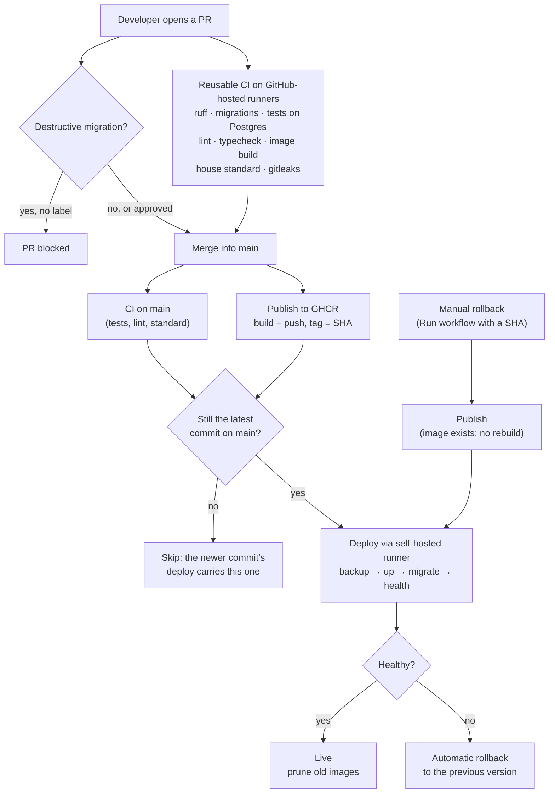
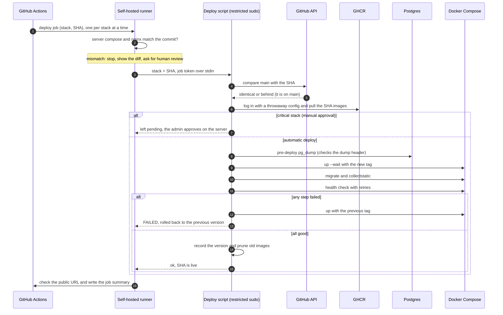
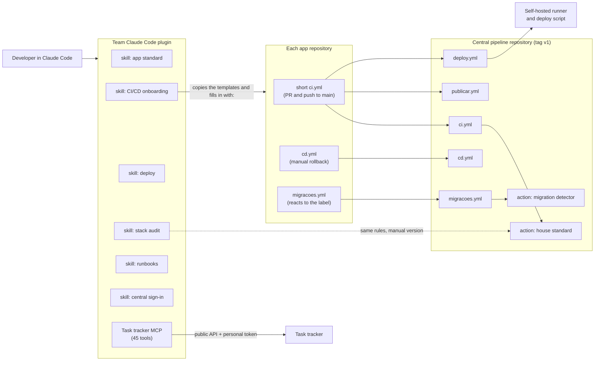

# Delivery Platform — standard CI/CD and Developer Experience for a law firm's apps


🇧🇷 [Versão em português](README.md)

## Context

A law firm in Manaus, Brazil, runs about a dozen in-house applications (Django, Next.js, Node) on a Docker server behind Cloudflare Tunnel. Every app shipped its own way: manual deploys on the server, compose files written in different styles, no shared check before reaching production and no standard path to roll back. This platform brings two pieces together: a **central pipeline repository** designed to be reused by every app (CI, image publishing and deploys with automatic rollback), already running in production for the pilot app with an adoption playbook for the others; and a **team plugin for Claude Code** that brings the same standard to whoever is coding — skills to create, onboard, audit and operate a stack, plus an MCP server that connects Claude to the team's task tracker.

## Highlights

- **Versioned reusable workflows (`@v1`)**: each app has three short files that call the central ones. CI runs tests against real Postgres and Redis, `ruff`, pending-migration checks, `check --deploy` (pointed at the production settings module when the app splits dev and prod), a smoke test proving the ASGI server (uvicorn) boots and answers the health endpoint, frontend lint and typecheck, image builds, `docker compose config`, `nginx -t` and `gitleaks` over the full history.
- **Destructive-migration gate**: a detector parses the migrations a PR adds or changes (AST analysis) and blocks `RemoveField`, `DeleteModel`, renames, `RunSQL` and edits to old migrations until the PR gets an approval label.
- **Images on GHCR tagged with the commit SHA**, published in parallel with the tests. The deploy waits for both and only proceeds if the commit **is still the latest on `main`** — a late deploy can never put an old version on top of a newer one.
- **Deploys through a self-hosted runner** that calls a single, narrowly privileged script: it verifies the commit is on `main` via the GitHub API, pulls the images, backs up the database, brings the stack up, migrates, runs `collectstatic`, health-checks and **rolls back to the previous version on its own if anything fails**.
- **Manual rollback by SHA**: one button in Actions; if the image already exists in the registry, nothing is rebuilt.
- **Automated house-standard check**: compose, Dockerfiles, nginx, an `.env.example` with no values, `DEBUG` read from the environment — errors block the PR; anything that slows builds or deploys becomes a warning linking to the fix. Newly onboarded stacks run in "adoption mode" (warnings only).
- **Measured optimization guide**: on the pilot app, merge-to-live time went from about 20 min to 1 min 43 s; the frontend image from 1.39 GB to 357 MB; the test suite from 172 s to 13 s (figures recorded in the project's documentation).
- **Claude Code plugin** with 6 skills (app standard, CI/CD onboarding, deploy, stack audit, incident runbooks, central sign-in integration) and an **MCP server with 45 tools** on top of the task tracker's API — tasks, checklists, comments, time tracking, personal board, delegation and attachments — using each person's own token.

## Screens

This is an infrastructure project, so there are no screens. The showcase relies on diagrams and an illustrative configuration snippet.

## Architecture — from PR to production



Unreviewed PR code only ever runs on GitHub-hosted runners. The self-hosted runner only receives deploy jobs from `main` and, even then, can run exactly one command: "put this SHA of this stack live".

## Deploy on the runner, step by step



## How each app consumes the platform



An app adopts the standard by copying three template workflows and filling in `with:`. An illustrative snippet (names replaced with placeholders; input names are in Portuguese, as in the original):

```yaml
jobs:
  ci:
    uses: <org>/<pipelines-repo>/.github/workflows/ci.yml@v1
    with:
      app: my-app
      dominio: my-app.example.com
      construir-imagens: ${{ github.event_name != 'push' }}  # on main, `publicar` builds
      imagens: >-
        [{"servico": "backend",  "contexto": "backend"},
         {"servico": "frontend", "contexto": "frontend"}]

  publicar:
    if: github.event_name == 'push' && github.ref == 'refs/heads/main'
    uses: <org>/<pipelines-repo>/.github/workflows/publicar.yml@v1
    permissions: { contents: read, packages: write }
    with:
      app: my-app
      imagens: >-
        [{"servico": "backend",  "contexto": "backend"},
         {"servico": "frontend", "contexto": "frontend"}]

  deploy:
    needs: [ci, publicar]
    uses: <org>/<pipelines-repo>/.github/workflows/deploy.yml@v1
    permissions: { contents: read, packages: read }
    with:
      app: my-app
      sha: ${{ needs.publicar.outputs.sha }}
```

## Stack

| Layer | Technologies |
|---|---|
| Pipelines | GitHub Actions (reusable workflows and composite actions), actions pinned by SHA |
| CI | Postgres and Redis as services, ruff, uvicorn (ASGI boot check), ESLint/TypeScript, Docker Buildx with `gha` cache, gitleaks, actionlint and shellcheck (self-test) |
| Registry | GitHub Container Registry, tag = full commit SHA |
| Deploy | Self-hosted runner, Bash script with `flock`, Docker Compose (`up --wait`), `pg_dump` |
| Checks | Python (PyYAML, `ast`) for the house standard and the migration detector |
| Maintenance | Dependabot for base-image digests only |
| Developer Experience | Claude Code plugin (private marketplace), Markdown skills, Python MCP server (MCP SDK + httpx), `SessionStart` hook |

## Technical decisions and challenges

- **The production runner trusts no one, not even its own workflow.** It runs as a user with no Docker access, and sudo allows a single command: `deploy <stack> <sha>`. The script checks via the GitHub API that the SHA is on `main`, receives the job token over stdin (never as an argument, never on disk) and logs in to the registry using a throwaway config. Rolling back, choosing an image and approving pending deploys are admin-only actions.
- **Compose and nginx never change through CD.** The deploy only swaps image tags; if the server's infrastructure files differ from the commit's, the job stops and shows the diff. A PR therefore cannot push `privileged`, a new volume or a new port to production without human review.
- **Publish in parallel with the tests, but ship only the latest commit.** Image builds no longer wait for CI; the deploy waits for both. A separate job checks that the commit is still the latest on `main` before joining the queue — GitHub's queue keeps only the most recent pending job, so a late deploy would otherwise take the newer one's place.
- **Automatic rollback, with its limit stated plainly.** Rolling back swaps the images but does not undo migrations. That is why there is a pre-deploy backup, validated by the dump header (size is useless: on the first deploy the database really is empty), and why destructive migrations are gated at PR time. The rollback also restarts nginx even when `up` fails halfway (nginx only resolves upstreams at startup and would return 502 for recreated containers), and it tells "site down" apart from "site up with an unhealthy auxiliary service".
- **Measure before optimizing.** The optimization guide shows how to time every job and every deploy step, and maps each symptom to a cause: base images without a digest (the server re-downloaded everything), Next.js without `standalone`, production password hashing in tests, healthchecks without `start_interval`. CI now warns about each one.
- **An MCP with no shortcuts.** The MCP server talks only to the task tracker's public API, with the user's personal token, so the same permissions, validations and history as the UI apply. Because Claude Code gives up connecting to an MCP server within seconds, the Python environment is prepared by a hook when the session opens, and the plugin's CI boots the MCP on Python 3.11 and 3.13 and checks the tool list.

## My role

I created both pieces and am the largest contributor to each. In the pipeline repository I wrote 11 of the 23 commits on `main` (8 of 14 excluding merges): the whole v1 (reusable workflows, migration detector, standard check, deploy script, server installer, app templates and docs), the fixes that came out of the pilot, the parallel pipeline (publish alongside tests, deploy only the latest commit), the optimization guide with Dependabot, the ASGI boot check in CI and the nginx-restart fix in the rollback. The remaining commits came from other team members: stack configuration, `pyproject.toml` support, a settings-module option for `check --deploy`, and installer checks. In the Claude Code plugin I wrote 18 of the 22 commits (11 of 13 excluding merges): the marketplace, five of the six skills, the MCP plugin (grown from 34 to 45 tools, adding the personal board, delegation and attachments), the launcher and the CI with a smoke test; the central sign-in integration skill came from another team member.

---

The source code of this project is private; this repository is a showcase only. Contact: [github.com/roger-mont](https://github.com/roger-mont).
