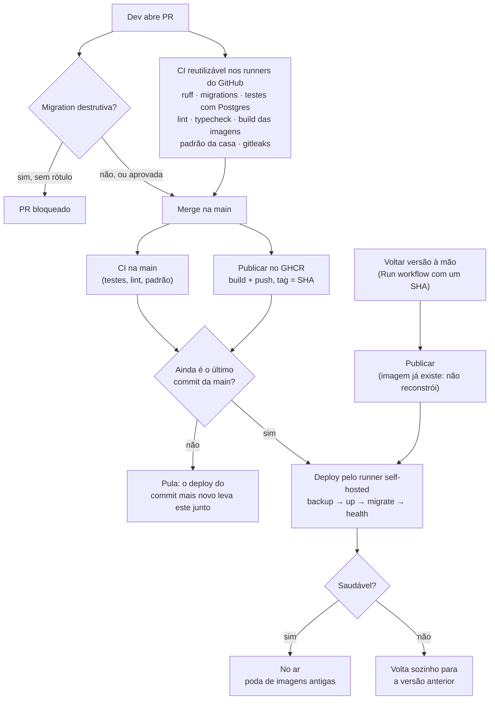
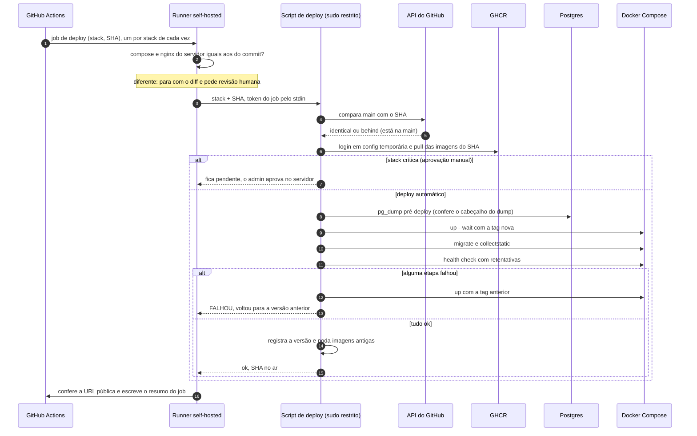
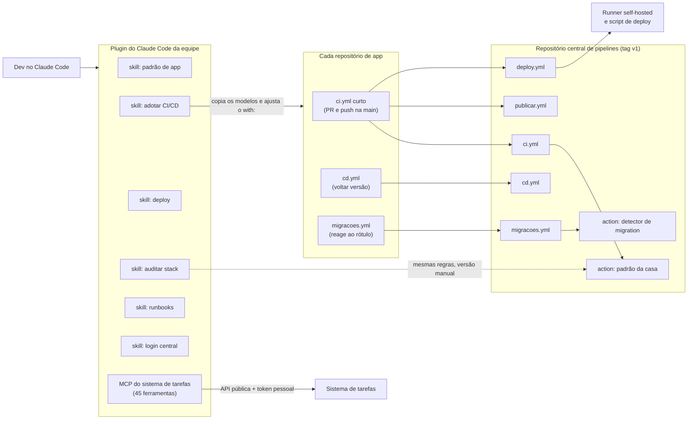

# Plataforma de entrega — CI/CD padrão e Dev Experience para as apps de um escritório


🇺🇸 [English version](README.en.md)

## Contexto

Um escritório de advocacia em Manaus roda cerca de uma dezena de aplicações próprias (Django, Next.js, Node) em um servidor com Docker, atrás de Cloudflare Tunnel. Cada app tinha o seu jeito de subir: deploy à mão no servidor, compose escrito de formas diferentes, sem uma conferência comum antes de ir para produção e sem caminho padrão para voltar uma versão. Esta plataforma junta duas peças: um **repositório central de pipelines** feito para ser reaproveitado por todas as apps (CI, publicação de imagens e deploy com volta automática), já em produção no app piloto e com um roteiro de adoção para as demais e um **plugin do Claude Code da equipe**, que leva o mesmo padrão para quem programa — com skills para criar, adotar, auditar e operar uma stack, e um servidor MCP que conecta o Claude ao sistema de tarefas da equipe.

## Destaques

- **Workflows reutilizáveis versionados (`@v1`)**: cada app tem três arquivos curtos que chamam os do repositório central. CI com testes em Postgres e Redis de verdade, `ruff`, migrations pendentes, `check --deploy` (com o módulo de settings de produção, quando a app separa dev e prod), prova de que o servidor ASGI (uvicorn) sobe e responde o health, lint e typecheck do frontend, build das imagens, `docker compose config`, `nginx -t` e `gitleaks` no histórico inteiro.
- **Bloqueio de migration destrutiva**: um detector lê as migrations que o PR adiciona ou altera (análise da AST) e barra `RemoveField`, `DeleteModel`, renomeações, `RunSQL` e edição de migration antiga até o PR ganhar um rótulo de aprovação.
- **Imagens no GHCR com tag = SHA do commit**, publicadas em paralelo com os testes. O deploy espera os dois e só segue se o commit **ainda for o último da `main`** — um deploy atrasado nunca põe uma versão velha por cima da nova.
- **Deploy por runner self-hosted** que chama um único script com privilégio restrito: confere o commit na `main` pela API do GitHub, baixa as imagens, faz backup do banco, sobe, migra, roda `collectstatic`, faz health check e **volta sozinho para a versão anterior se algo falhar**.
- **Voltar versão à mão por SHA**: um botão no Actions; se a imagem já existe no registry, não reconstrói.
- **Verificação automática do padrão da casa**: compose, Dockerfiles, nginx, `.env.example` sem valores, `DEBUG` lido do ambiente — erro bloqueia o PR; o que deixa build ou deploy lento vira aviso com o link da correção. Stack recém-chegada entra em "modo adoção" (só avisos).
- **Guia de otimização medido**: no app piloto, o tempo do merge até o ar caiu de cerca de 20 min para 1 min 43 s; imagem do frontend de 1,39 GB para 357 MB; testes de 172 s para 13 s (números registrados na documentação do projeto).
- **Plugin do Claude Code** com 6 skills (padrão de app, adotar CI/CD, deploy, auditar stack, runbooks de incidente, integração com o login central) e um **servidor MCP com 45 ferramentas** sobre a API do sistema de tarefas — tarefas, checklist, comentários, cronômetro, quadro pessoal, delegação e anexos —, usando o token pessoal de cada pessoa.

## Telas

Projeto de infraestrutura: não há telas. A vitrine é feita com diagramas e um trecho ilustrativo de configuração.

## Arquitetura — do PR ao ar



O código de PR, que ainda não foi revisado, só roda nos runners do GitHub. O runner self-hosted só recebe jobs de deploy da `main` e, mesmo assim, só consegue executar um comando: "ponha este SHA desta stack no ar".

## Deploy no runner, passo a passo



## Como cada app consome a plataforma



Uma app adota o padrão copiando três workflows de modelo e preenchendo o `with:`. Um trecho ilustrativo (nomes trocados por placeholders):

```yaml
jobs:
  ci:
    uses: <org>/<repo-de-pipelines>/.github/workflows/ci.yml@v1
    with:
      app: minha-app
      dominio: minha-app.example.com
      construir-imagens: ${{ github.event_name != 'push' }}  # na main quem constrói é o publicar
      imagens: >-
        [{"servico": "backend",  "contexto": "backend"},
         {"servico": "frontend", "contexto": "frontend"}]

  publicar:
    if: github.event_name == 'push' && github.ref == 'refs/heads/main'
    uses: <org>/<repo-de-pipelines>/.github/workflows/publicar.yml@v1
    permissions: { contents: read, packages: write }
    with:
      app: minha-app
      imagens: >-
        [{"servico": "backend",  "contexto": "backend"},
         {"servico": "frontend", "contexto": "frontend"}]

  deploy:
    needs: [ci, publicar]
    uses: <org>/<repo-de-pipelines>/.github/workflows/deploy.yml@v1
    permissions: { contents: read, packages: read }
    with:
      app: minha-app
      sha: ${{ needs.publicar.outputs.sha }}
```

## Stack

| Camada | Tecnologias |
|---|---|
| Pipelines | GitHub Actions (workflows reutilizáveis e composite actions), ações fixadas por SHA |
| CI | Postgres e Redis como services, ruff, uvicorn (prova de subida ASGI), ESLint/TypeScript, Docker Buildx com cache `gha`, gitleaks, actionlint e shellcheck (autoteste) |
| Registry | GitHub Container Registry, tag = SHA completo do commit |
| Deploy | Runner self-hosted, script Bash com `flock`, Docker Compose (`up --wait`), `pg_dump` |
| Verificações | Python (PyYAML, `ast`) para o padrão da casa e o detector de migration |
| Manutenção | Dependabot só para o digest das imagens base |
| Dev Experience | Plugin do Claude Code (marketplace próprio), skills em Markdown, servidor MCP em Python (SDK do MCP + httpx), hook `SessionStart` |

## Decisões técnicas e desafios

- **O runner de produção não confia em ninguém, nem no próprio workflow.** Ele roda com um usuário sem acesso ao Docker, e o sudo só libera um comando: `deploy <stack> <sha>`. O script confere pela API do GitHub se o SHA está na `main`, recebe o token do job pelo stdin (nunca em argumento nem em disco) e faz o login no registry numa configuração temporária. Voltar versão, escolher imagem e aprovar pendências são ações só do administrador.
- **Compose e nginx não mudam pelo CD.** O deploy só troca a tag das imagens; se os arquivos de infraestrutura do servidor forem diferentes dos do commit, o job para e mostra o diff. Assim um PR não consegue mandar `privileged`, um volume ou uma porta nova para a produção sem revisão humana.
- **Publicar em paralelo com os testes, mas implantar só o último commit.** O build das imagens deixou de esperar a CI, e o deploy espera os dois. Um job à parte confere se o commit ainda é o último da `main` antes de entrar na fila — a fila do GitHub guarda só o pendente mais recente, e um deploy atrasado tomaria o lugar do mais novo.
- **Rollback automático, com o limite dito com todas as letras.** A volta automática troca as imagens, mas não desfaz migration. Por isso existe o backup pré-deploy, validado pelo cabeçalho do dump (o tamanho não serve: no primeiro deploy o banco está vazio mesmo), e o bloqueio de migration destrutiva ainda no PR. A volta também reinicia o nginx mesmo quando o `up` falha no meio (ele só resolve os upstreams ao iniciar e responderia 502 para os containers recriados) e distingue "site fora do ar" de "site no ar com um serviço auxiliar doente".
- **Medir antes de otimizar.** O guia de otimização mostra como cronometrar cada job e cada passo do deploy e liga cada sintoma a uma causa: imagem base sem digest (o servidor baixava tudo de novo), Next.js sem `standalone`, hash de senha de produção nos testes, healthcheck sem `start_interval`. A CI passou a avisar sobre cada um.
- **MCP sem atalhos.** O servidor MCP só fala com a API pública do sistema de tarefas, com o token pessoal de quem usa: valem as mesmas permissões, validações e histórico da tela. Como o Claude Code desiste de conectar um MCP em poucos segundos, o ambiente Python é preparado por um hook na abertura da sessão, e a CI do plugin sobe o MCP em Python 3.11 e 3.13 e confere a lista de ferramentas.

## Meu papel

Criei as duas peças e sou o maior contribuidor de ambas. No repositório de pipelines, fiz 11 dos 23 commits da `main` (8 dos 14, sem contar merges): a versão 1 inteira (workflows reutilizáveis, detector de migration, verificação do padrão, script de deploy, instalador do servidor, modelos para as apps e documentação), as correções que vieram do piloto, a esteira paralela (publicar junto com os testes, deploy só do último commit), o guia de otimização com o Dependabot, a prova de subida do ASGI na CI e a correção do reinício do nginx no rollback. Os demais commits vieram de outros membros da equipe: configuração de stacks, suporte a `pyproject.toml`, módulo de settings no `check --deploy` e conferências do instalador. No plugin do Claude Code, fiz 18 dos 22 commits (11 dos 13, sem contar merges): o marketplace, cinco das seis skills, o plugin MCP (de 34 para 45 ferramentas, com quadro pessoal, delegação e anexos), o launcher e a CI com smoke test; a skill de integração com o login central veio de outro membro da equipe.

---

O código deste projeto é privado; este repositório é só uma vitrine. Contato: [github.com/roger-mont](https://github.com/roger-mont).
